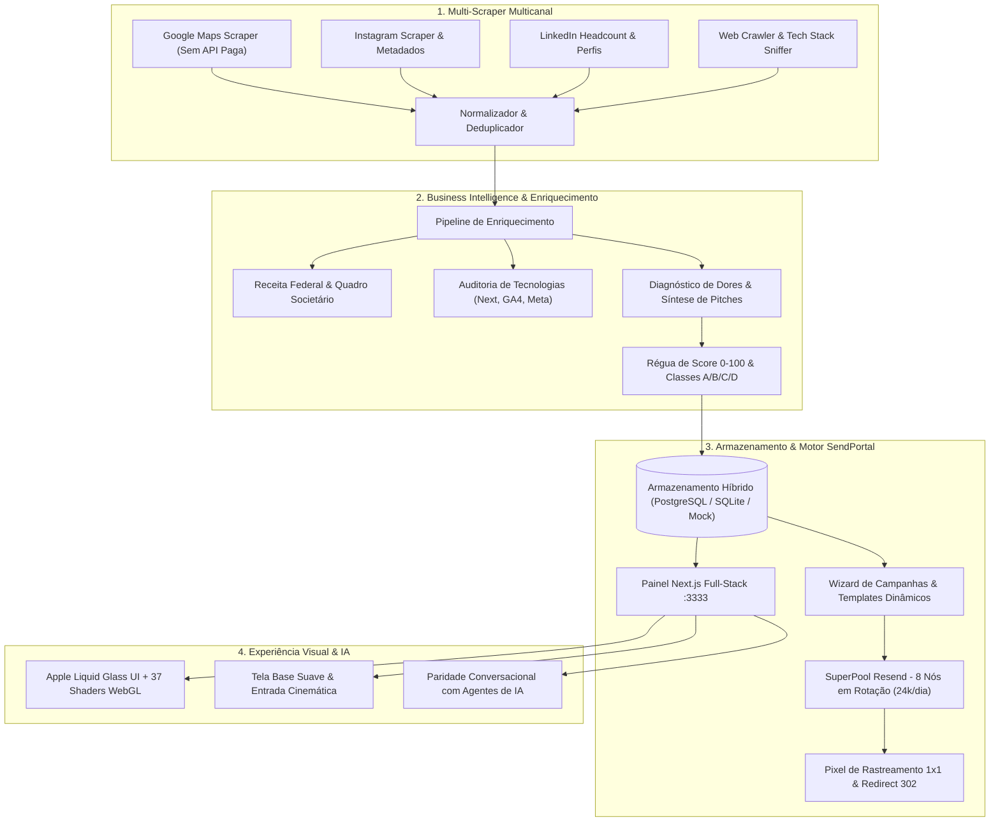

# Client Hunter PRO 🎯✉️
### Suíte Unificada de Prospecção Multicanal, Business Intelligence & Cold Outreach Enterprise
> **Versão de Demonstração & Portfólio de Engenharia de Software**  
> *Mantenedor:* **Mateus Celestino** (`@MateusCelestinoProX`)  
> *Contato Oficial:* `Mateus Celestino <202405039459@alunos.estacio.br>`

---

## 🌟 Sobre esta Demonstração (Demo Showcase)

Esta versão do **Client Hunter** foi desenvolvida para exibição técnica de portfólio de engenharia de software de alto padrão, combinando:

1. **Tela Base Suave & Entrada Cinemática**: Inicialização com overlay translúcido Apple Liquid Glass, diagnóstico dinâmico do sistema e cascateamento animado da interface completa (TopBar, Sidebar, métricas e tabela de leads).
2. **Dataset 100% Sanitizado (Privacy Shield)**: Todos os dados proprietários, pessoais e credenciais privadas foram substituídos por dados *mock/fake* de alta fidelidade técnica (empresas fictícias, CNPJs estruturados, sócios, dossiês de BI e telemetria de cluster).
3. **Execução Zero-Config**: Funciona instantaneamente sem necessidade de banco de dados externo ou chaves de API, mantendo todas as telas, filtros, wizards e modais 100% interativos.
4. **Modo Sandbox Interativo**: Permite testar o fluxo de disparo de campanhas, enriquecimento autônomo com BI, cálculo de métricas (taxa de abertura e cliques) e alternância responsiva de templates (Desktop 600px vs Mobile 375px).

---

## 🏗️ Arquitetura do Software



---

## 🚀 Como Executar a Demonstração Localmente

### 1. Clonar o Repositório
```bash
git clone https://github.com/MateusCelestinoProX/client-hunter-demo.git
cd client-hunter-demo
```

### 2. Iniciar o Painel Web
```bash
cd painel
npm install
npm run dev -- -p 3333
```
Acesse no seu navegador: **[http://localhost:3333](http://localhost:3333)**

Ao entrar, a demonstração iniciará automaticamente com a **tela base de apresentação** e transição suave para o painel de controle. Você pode reiniciar a apresentação a qualquer momento pelo botão flutuante `✦ Modo Demo Ativo` no canto inferior direito.

---

## 💎 Destaques Técnicos & Módulos

### 1. Multi-Scraper Multicanal
- Extração profunda de estabelecimentos no Google Maps por nicho e cidade.
- Varredura de metadados em sites institucionais (WhatsApp direto, e-mails comerciais, scripts de rastreamento).
- Deduplicação inteligente por domínio, telefone normalizado e raiz de CNPJ.

### 2. Motor Autônomo de Business Intelligence (BI)
- Consulta automatizada de dados cadastrais (Razão Social, CNPJ, Data de Abertura, Capital Social, Sócios).
- Auditoria de presença digital (versão mobile, Google Tag Manager, Pixel da Meta, tempo de resposta).
- Síntese de diagnósticos comerciais e ganchos personalizados de alta conversão para WhatsApp, E-mail e LinkedIn.

### 3. SendPortal Enterprise & SuperPool Cluster
- Rotação balanceada entre **8 nós Resend** para capacidade de até 24.000 envios/dia.
- Previews responsivos de templates dinâmicos: **Desktop (600px)** e **Mobile (375px)** com variáveis `{{first_name}}`, `{{company}}`, `{{nicho}}` e `{{unsubscribe_url}}`.
- Mecanismo rigoroso de opt-out em conformidade com a LGPD e RFC 8058.

### 4. Design System Apple Liquid Glass
- Vidro líquido translúcido com saturação dinâmica (`backdrop-filter: blur(36px) saturate(200%)`).
- Seletor integrado de **37 Shaders WebGL** para personalização de ambiência visual.
- Command Palette global acessível via teclado (`⌘K` / `Ctrl+K`).

---

## 🔒 Privacidade e Identidade

- **Mantenedor Oficial:** `Mateus Celestino <202405039459@alunos.estacio.br>`
- **Perfil GitHub:** [`@MateusCelestinoProX`](https://github.com/MateusCelestinoProX)
- **Licença:** MIT (Demonstração Pública de Portfólio)
